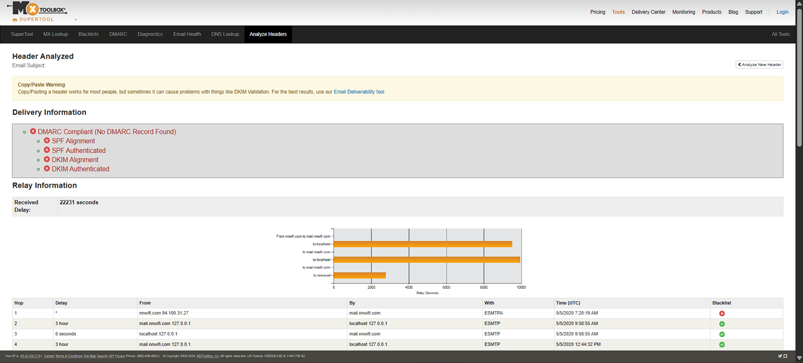
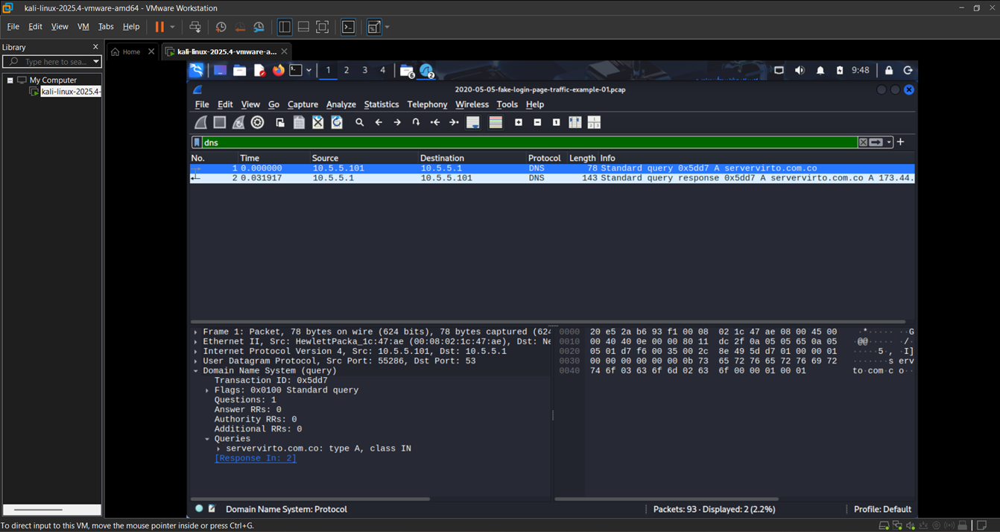
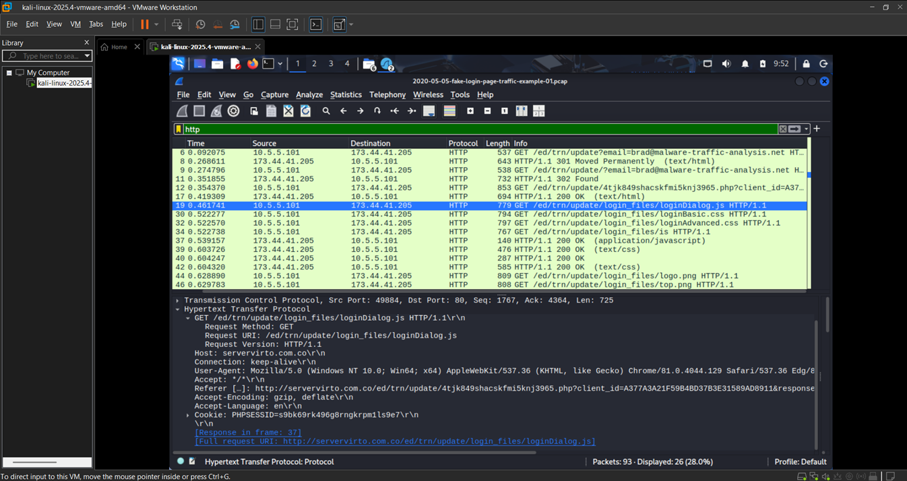

# 🚨 Phishing Email Investigation with Network Traffic Analysis

### 👤 Vignesh Kilambi | Aspiring SOC Analyst

---

## 📌 Description

Phishing email investigation with header analysis, IOC extraction, and Wireshark-based network traffic analysis performed in a controlled SOC lab environment.

---

## 📌 Overview

This project demonstrates a real-world phishing email investigation conducted in a SOC environment. The analysis includes email inspection, header analysis, IOC extraction, and network traffic investigation using Wireshark to identify malicious activity and credential harvesting behavior.

---

## 🛠️ Tools Used

* Kali Linux
* Wireshark
* MXToolbox

---

## 🔍 Investigation Process

### 📧 Phishing Email Analysis

* Identified suspicious sender email (domain mismatch)
* Detected malicious link embedded in email content
* Observed social engineering techniques used to trigger user action

---

### 📨 Email Header Analysis (MXToolbox)

* SPF, DKIM, and DMARC authentication failed
* Sender IP identified as suspicious
* Confirmed spoofed phishing email

*Shows failed authentication checks confirming spoofed email*

---

### 🧪 IOC Extraction

* Extracted malicious indicators from email and network traffic
* Identified domains, IP address, URL, and file involved

---

## 🌐 Network Traffic Analysis (Wireshark)

### DNS Analysis

* Observed DNS query for malicious domain
* Domain resolution confirms attacker-controlled infrastructure

*Shows DNS query to malicious domain `servervirto.com.co`*

---

### HTTP Analysis

* Detected HTTP request to phishing domain
* JavaScript file retrieved (`loginDialog.js`)
* Indicates credential harvesting activity

*Shows HTTP request and retrieval of malicious JavaScript file*

---

## 🔎 Key Findings

* The email was confirmed as a phishing attempt due to domain spoofing and failed authentication checks
* Malicious domain `servervirto.com.co` was contacted via DNS and HTTP
* JavaScript file (`loginDialog.js`) indicates credential harvesting behavior
* Network traffic confirms communication with attacker-controlled infrastructure

---

## 🔗 Attack Flow

Phishing Email
↓
User clicks malicious link
↓
DNS request → servervirto.com.co
↓
HTTP request → phishing page
↓
JavaScript loaded (loginDialog.js)
↓
Credentials captured

---

## 🧠 MITRE ATT&CK Mapping

* T1566 – Phishing
* T1204 – User Execution
* T1071 – Web Communication

---

## 🧠 Skills Demonstrated

* Email Threat Analysis
* IOC Extraction & Analysis
* Network Traffic Analysis (Wireshark)
* Threat Detection & Investigation
* MITRE ATT&CK Mapping

---

## ⚠️ Impact

* Credential theft possible
* Unauthorized account access
* Sensitive data compromise

---

## 📊 Indicators of Compromise (IOCs)

| Type   | Value                                                              |
| ------ | ------------------------------------------------------------------ |
| Email  | [sues@nnwifi.com](mailto:sues@nnwifi.com)                          |
| Domain | nnwifi.com                                                         |
| IP     | 94.100.31.27                                                       |
| Domain | servervirto.com.co                                                 |
| URL    | http://servervirto.com.co/ed/trn/update/login_files/loginDialog.js |
| File   | loginDialog.js                                                     |

---

## 📊 Evidence

* Phishing email sample (.eml)
* Extracted IOCs
* MXToolbox header analysis screenshots
* Wireshark DNS & HTTP analysis screenshots

---

## 📂 PCAP File

Due to security considerations, the PCAP file containing simulated malicious traffic is hosted externally:

🔗 [Download PCAP](PASTE-YOUR-GOOGLE-DRIVE-LINK-HERE)

---

## ⚠️ Disclaimer

This project contains simulated phishing and malicious network traffic generated in a controlled lab environment (Kali Linux).
It is intended strictly for educational and research purposes only.
All analysis was conducted in an isolated environment to safely handle malicious artifacts.

---

## ✅ Conclusion

The phishing attack was successfully identified by correlating email analysis with network traffic data.
The investigation confirmed credential harvesting behavior through malicious JavaScript delivery, demonstrating how phishing attacks leverage both social engineering and network-based techniques.

---

## 👤 Author

**Vignesh Kilambi**
Aspiring SOC Analyst
